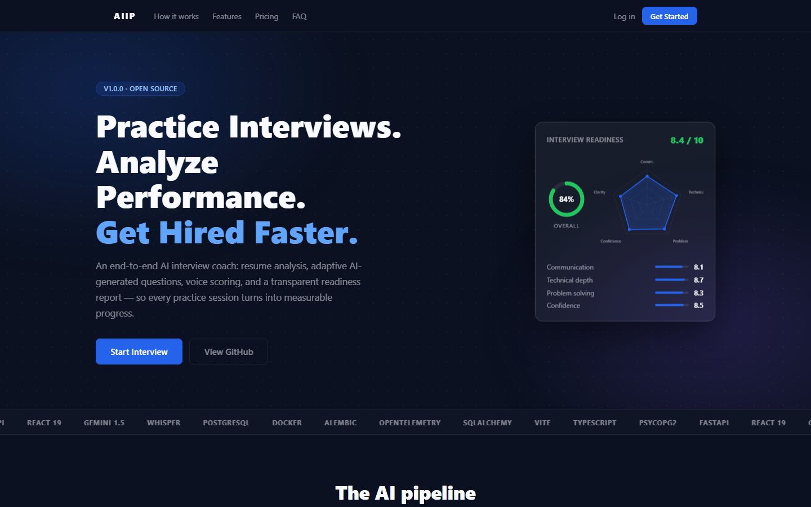
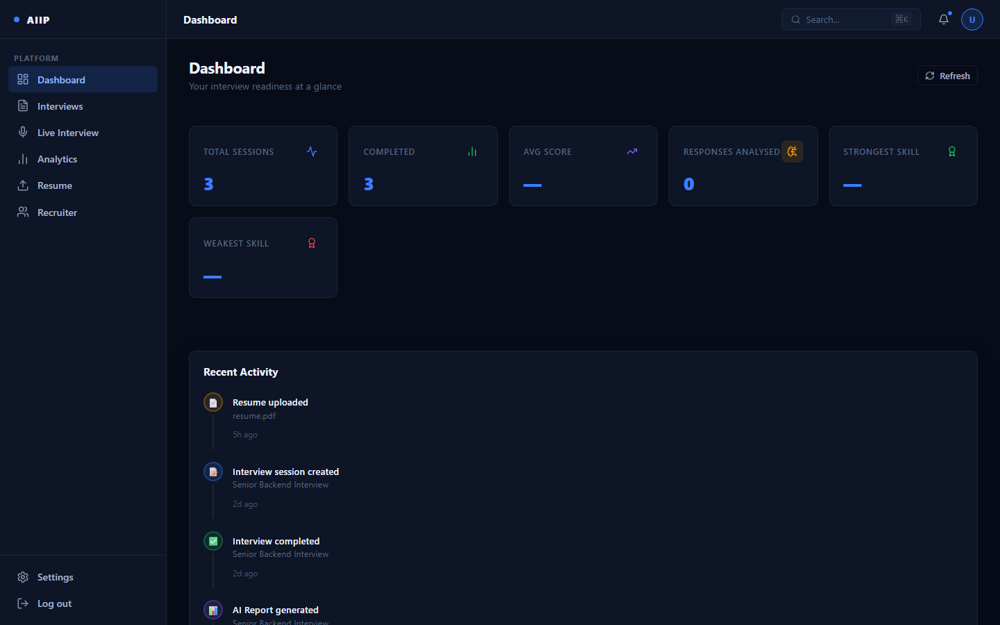
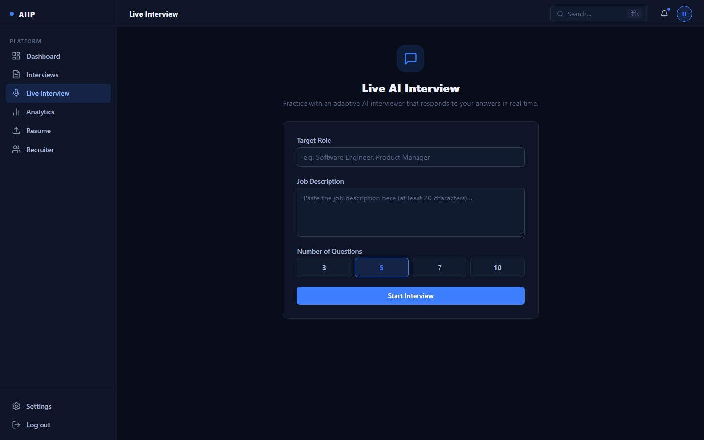
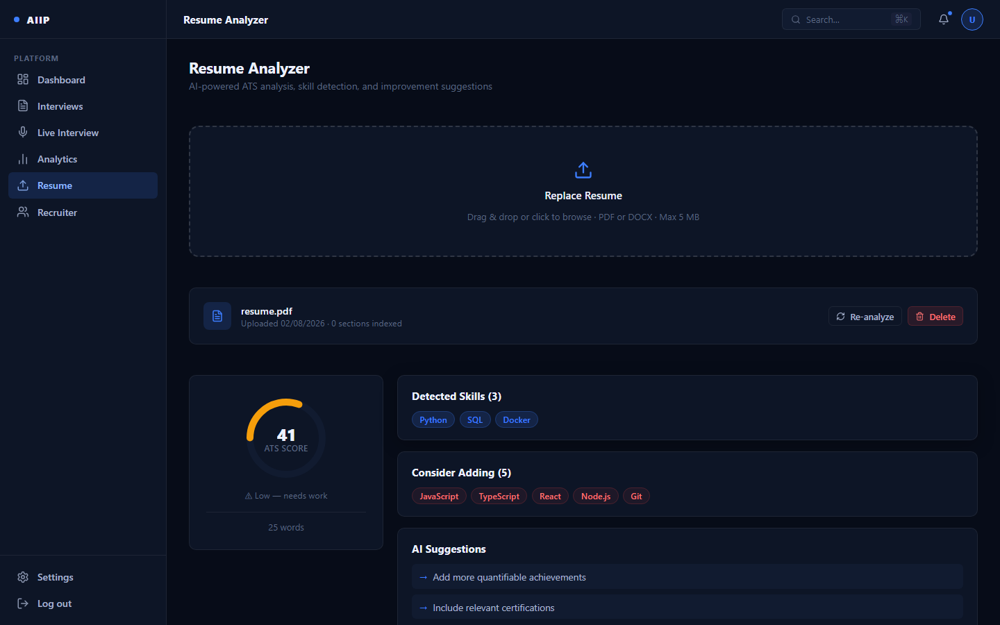
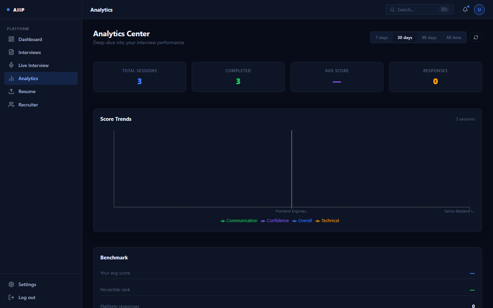
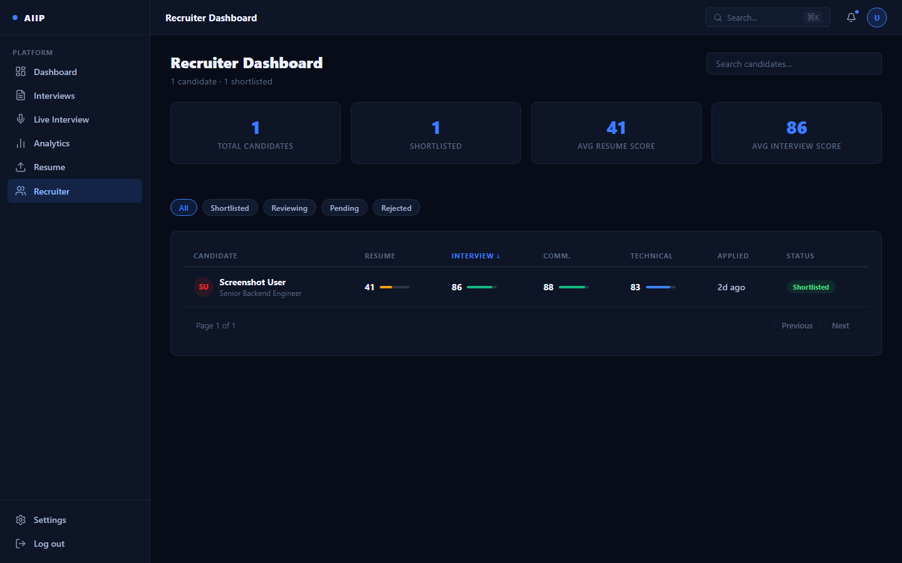
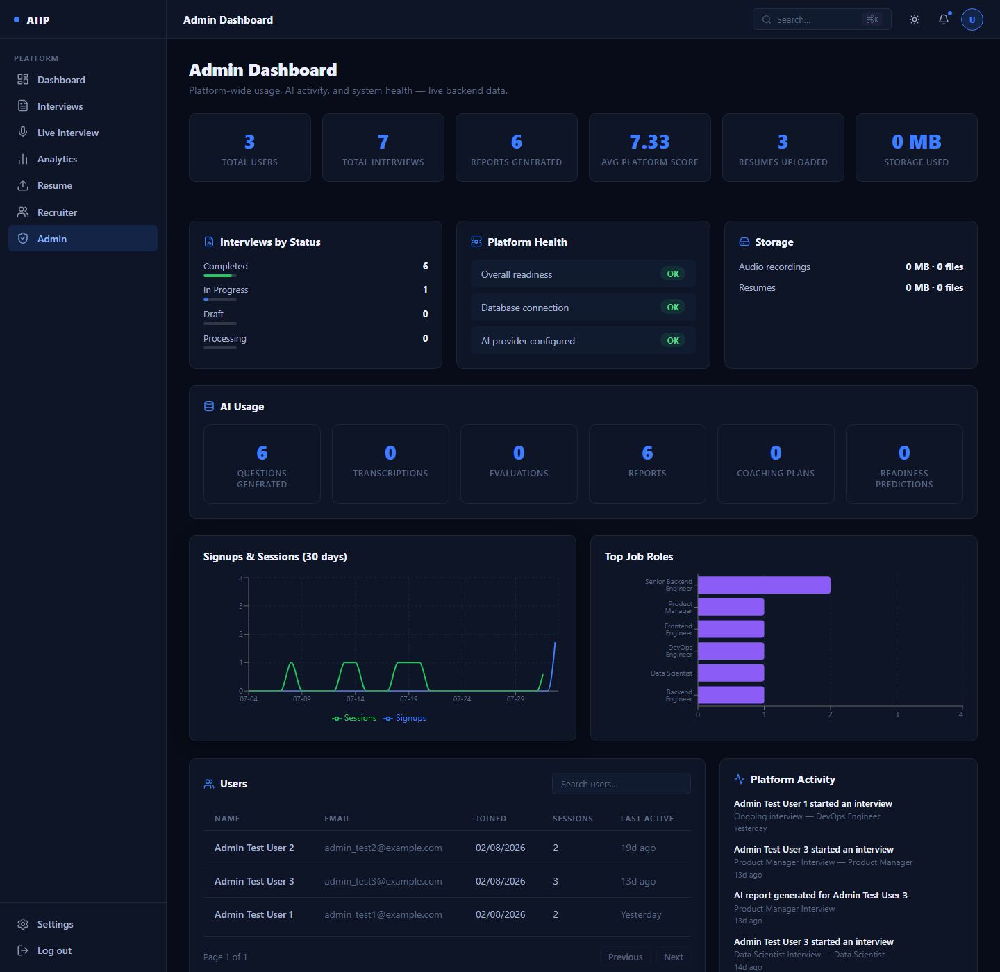
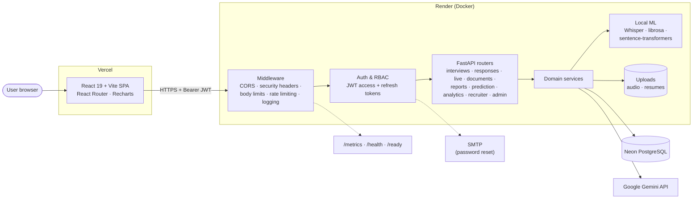
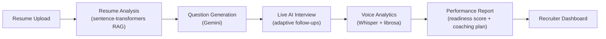
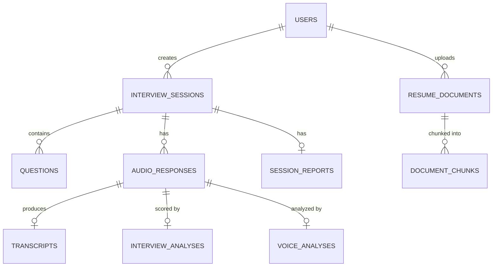

<div align="center">

# AI Interview Intelligence Platform

[](https://ai-interview-intelligence-platform.vercel.app/)

**AI-powered mock interview practice: question generation, audio transcription,
multi-dimensional evaluation, voice analytics, live conversational interviews,
resume-aware RAG questions, a transparent interview readiness score, and AI
career coaching.**

[](https://github.com/KeerthanaPothula/ai-interview-intelligence-platform/actions/workflows/ci.yml)
[](https://github.com/KeerthanaPothula/ai-interview-intelligence-platform/actions/workflows/security.yml)


**[Live demo](https://ai-interview-intelligence-platform.vercel.app/)** · **[Screenshots](#screenshots)** · **[Architecture](#system-architecture)** · **[API docs](docs/API.md)**

</div>

---

### Demo

> **Live site:** <https://ai-interview-intelligence-platform.vercel.app/>
>
> The hosted demo's backend runs on Render's **free plan**: the first request
> after it has been idle takes about 30–40 seconds (cold start). To fit
> in 512 MB of RAM, **audio processing (Whisper/librosa) and
> sentence-transformer embeddings are turned off** there
> (`ENABLE_AUDIO_PROCESSING=false`, `ENABLE_EMBEDDINGS=false` in
> [render.yaml](render.yaml)). Typed answers, live interviews, resume-based
> questions, reports, readiness scoring, and analytics all still work. Run the
> project locally to use the full audio pipeline.
>
> An animated walkthrough (resume upload → live interview → readiness report)
> hasn't been recorded yet (see the [Roadmap](#roadmap)). For now, the
> [Screenshots](#screenshots) section shows every major screen from a running
> instance.

---

## Table of contents

- [Project overview](#project-overview)
- [Screenshots](#screenshots)
- [Key features](#key-features)
- [Technology stack](#technology-stack)
- [System architecture](#system-architecture)
- [AI pipeline](#ai-pipeline)
- [How it works](#how-it-works)
- [Installation and setup](#installation-and-setup)
- [Environment variables](#environment-variables)
- [Folder structure](#folder-structure)
- [Database](#database)
- [API](#api)
- [Deployment](#deployment)
- [Testing](#testing)
- [CI/CD](#cicd)
- [Monitoring & observability](#monitoring--observability)
- [Performance](#performance)
- [Security](#security)
- [Documentation](#documentation)
- [Contributing](#contributing)
- [Roadmap](#roadmap)
- [Acknowledgements](#acknowledgements)
- [License](#license)

---

## Project overview

### The problem

Interview practice usually means rehearsing alone with no feedback, or
relying on a friend who can't tell you how you compare to other candidates.
Generic question banks aren't based on your own resume or the job you're
applying for, and almost nothing measures *how* you answered: pace, pauses,
filler words, structure.

### How AI helps

The platform turns a resume and a job description into a personalized,
measurable practice loop:

- **Gemini** generates questions for a specific role and job description. It
  also uses resume content retrieved through a small RAG pipeline (resume
  chunks ranked by sentence-transformer embeddings).
- **Whisper** transcribes recorded answers. **librosa** measures speaking rate,
  pauses, filler words, and energy consistency.
- **Gemini** scores every answer on five dimensions with specific strengths,
  weaknesses, and feedback. It can also run a live, multi-turn interview that
  adapts to what you said.
- A **transparent, documented readiness formula** and percentile benchmarking
  show your progress over time. The formula is a weighted average, not a
  trained model that predicts hiring outcomes (see
  [docs/AI_PIPELINE.md §9](docs/AI_PIPELINE.md#9-interview-readiness-scoring--benchmarking-prediction_servicepy-benchmark_servicepy)).
- An **AI career coach** turns your weak areas into 7/14/30-day improvement
  plans.

### Who it's for

| Role | What they get |
|---|---|
| **Candidates** (students, job seekers, career switchers) | Mock interviews, AI feedback, analytics, readiness score, coaching plans, PDF-exportable reports |
| **Recruiters** | A searchable, sortable ranking of candidates by their latest completed interview, with read access to candidate reports |
| **Admins** | Platform-wide stats on users, interviews, AI usage, storage, and health |

The project is built like a production service: JWT auth with refresh-token
rotation, role-based access control, Alembic-migrated PostgreSQL, hardened
CORS and security headers, structured logging, Prometheus metrics, optional
OpenTelemetry tracing, a multi-stage Docker build, and GitHub Actions CI.

## Screenshots

All screenshots come from a real running instance with seeded data, not
mockups. The landing page (`/`) shows the same images in an auto-advancing
carousel.

<table>
  <tr>
    <td width="50%"><p align="center"><b>Landing page</b>: AI pipeline timeline, architecture overview, screenshot carousel</p></td>
    <td width="50%"><p align="center"><b>Candidate dashboard</b>: sessions, scores, and progress at a glance</p></td>
  </tr>
  <tr>
    <td width="50%"><p align="center"><b>Live AI interview</b>: multi-turn interview with adaptive follow-up questions</p></td>
    <td width="50%"><p align="center"><b>Resume analysis</b>: upload a PDF/DOCX resume that feeds RAG question generation</p></td>
  </tr>
  <tr>
    <td width="50%"><p align="center"><b>Analytics center</b>: score trends and skill-breakdown radar</p></td>
    <td width="50%"><p align="center"><b>Recruiter dashboard</b>: searchable, sortable candidate ranking</p></td>
  </tr>
  <tr>
    <td width="50%"><p align="center"><b>Admin dashboard</b>: users, interviews, AI usage, storage, platform health</p></td>
    <td width="50%"></td>
  </tr>
</table>

An earlier, separate set of auth-flow screenshots (login, register, an
empty session list/detail) is in `docs/screenshots/`. See
[docs/screenshots.md](docs/screenshots.md).

## Key features

### AI interview engine
- **Question generation**: Gemini generates questions for the session's job
  role and job description, labeled behavioral, technical, or situational,
  and ordered.
- **Resume- and JD-based RAG questions**: upload a PDF/DOCX resume. Its text
  is extracted and split into 200-word overlapping chunks, and each chunk is
  embedded with sentence-transformers (`all-MiniLM-L6-v2`). The chunks most
  similar (by cosine similarity) to the session's role and job description
  are passed to Gemini to generate questions grounded in your experience.
  When embeddings are disabled, the first chunks are used instead.
- **Two ways to answer**: upload a recorded audio answer, or type a text
  answer to any question.
- **Transcription and evaluation**: Whisper transcribes audio answers, and
  Gemini scores each answer on five dimensions with strengths, weaknesses,
  and feedback.
- **Live conversational interviewer**: a multi-turn interview where each new
  question builds on your previous answers and gets harder as it goes.
- **Follow-up interviewer**: Gemini writes follow-up questions aimed at
  vague or interesting parts of an answer, with the conversation history
  saved.
- **Reliability layer**: every Gemini call goes through a shared
  retry/backoff and JSON-repair layer (`app/core/ai_reliability.py`).

### Voice analytics
- librosa-based acoustic analysis: speaking rate (WPM), pause detection,
  filler-word counting, RMS energy consistency, and a combined confidence
  score (0–100).
- Runs as an optional, best-effort step, so a failure here never blocks the
  transcript or evaluation.

### Readiness and coaching
- **Interview Readiness Score**: a transparent weighted average of a
  session's own scores, mapped to `Excellent` / `Strong` / `Developing` /
  `Needs Improvement`, plus a percentile benchmark against all platform
  users. It's a deterministic formula, not a trained ML model, and it does
  not predict real-world hiring outcomes. The exact weights are in
  [docs/AI_PIPELINE.md §9](docs/AI_PIPELINE.md#9-interview-readiness-scoring--benchmarking-prediction_servicepy-benchmark_servicepy).
- **AI career coach**: Gemini-generated 7/14/30-day improvement plans, based
  on a session's scores, readiness level, and weaknesses.

### Dashboards and reports
- **Analytics dashboard**: a score-trend line chart and a skill-breakdown
  radar chart across sessions.
- **Session reports**: a Gemini-generated summary of the whole session, with
  strengths and weaknesses, an improvement plan, and a readiness level.
- **PDF export**: one-click "Export to PDF" on the report page, using the
  browser's print-to-PDF.
- **Recruiter dashboard**: each candidate's latest completed interview,
  combined into a searchable, sortable, paginated ranking.
- **Admin dashboard**: users, interviews, AI usage, storage, and platform
  health, all from real queries with no mock data.

### Accounts and security
- Registration, login, "remember me", profile editing, password change,
  log out of all devices, and password reset by email (SMTP).
- **Role-based access control**: `candidate`, `recruiter`, `admin`, and
  `super_admin` roles, enforced by the backend's permission checks and by
  the frontend's route guards (`RequireRole`).
- bcrypt password hashing, JWT access tokens that can be revoked instantly
  (`token_version` claim), and rotating refresh tokens stored only as
  SHA-256 hashes.
- Per-IP rate limiting on login and AI endpoints, plus an account lockout
  that waits longer after each failed attempt.
- Layered upload validation (MIME allow-list, size limit, magic-byte
  signature check, filename sanitization) and security headers on every
  response.

### UX
- Dark/light themes (centralized design tokens, saved between visits, WCAG-AA
  contrast), toasts, skeleton loaders, empty/error states, an offline
  banner, and code splitting per route.

## Technology stack

### Frontend

| Technology | Purpose |
|---|---|
| React 19 + TypeScript | UI |
| Vite | Build tool and dev server |
| React Router v6 | Routing, role-guarded routes |
| Recharts | Score-trend line chart and skill radar chart |
| Framer Motion | Landing-page and UI animation |
| lucide-react | Icons |

### Backend

| Technology | Purpose |
|---|---|
| FastAPI + Uvicorn | Web framework and ASGI server |
| SQLAlchemy 2.x | ORM |
| Alembic | Database migrations |
| Pydantic v2 / pydantic-settings | Schemas and typed, validated settings |
| pypdf, python-docx | Resume text extraction |

### Database

| Technology | Purpose |
|---|---|
| PostgreSQL 16 | Docker Compose (local); Neon PostgreSQL in production |
| SQLite (in-memory) | Test suite |

### AI/ML

| Technology | Purpose |
|---|---|
| Google Gemini (`google-genai`) | Questions, evaluation, follow-ups, live interviews, RAG questions, reports, coaching |
| OpenAI Whisper + PyTorch (CPU) | Audio transcription (runs locally, no external API) |
| librosa | Voice and acoustic analytics |
| sentence-transformers (`all-MiniLM-L6-v2`) | Resume embeddings for RAG |

### Authentication and security

| Technology | Purpose |
|---|---|
| python-jose | Signing and verifying JWT access tokens |
| bcrypt | Password hashing |
| Custom middleware | Security headers, request-body limits, rate limiting, RBAC |

### Deployment and infrastructure

| Technology | Purpose |
|---|---|
| Vercel | Frontend static hosting (`frontend/vercel.json`) |
| Render | Backend Docker web service (`render.yaml`) |
| Neon | Managed PostgreSQL |
| Docker (multi-stage, non-root) + Docker Compose | Backend image and local dev stack |
| GitHub Actions | CI (`ci.yml`) and security scanning (`security.yml`) |
| Prometheus / OpenTelemetry | Metrics and tracing |

### Testing

| Technology | Purpose |
|---|---|
| pytest + httpx | Backend (600+ test functions) |
| Vitest + React Testing Library | Frontend (170+ test cases) |
| Playwright | End-to-end (1 full-flow spec, run locally only because it needs a real Gemini key) |

## System architecture



Every request from the SPA goes through the middleware stack, then the auth
dependency (JWT validation plus role checks), and then a router. All
business logic is in `app/services/`. Gemini is the only external AI API.
Whisper, librosa, and sentence-transformers run inside the backend process
and can each be switched off with an environment variable. Full system,
request-flow, auth-flow, and deployment diagrams are in
**[docs/ARCHITECTURE.md](docs/ARCHITECTURE.md)**.

## AI pipeline

Seven stages, from upload to the recruiter-facing dashboard:



1. **Resume Upload**: the PDF/DOCX is parsed and split into 200-word overlapping chunks.
2. **Resume Analysis**: chunks are embedded with `sentence-transformers` (`all-MiniLM-L6-v2`), and cosine-similarity retrieval bases question generation on the candidate's actual experience (RAG).
3. **Question Generation**: Gemini generates categorized (behavioral/technical/situational) questions from the resume and the target job description.
4. **Live AI Interview**: a multi-turn conversational session where each follow-up question is generated from the candidate's previous answer.
5. **Voice Analytics**: Whisper transcribes recorded answers, and `librosa` measures speaking rate, pauses, filler words, and energy consistency.
6. **Performance Report**: Gemini writes a summary report, and a transparent, documented weighted formula computes the Interview Readiness Score. It isn't a trained outcome-prediction model (see [docs/AI_PIPELINE.md §9](docs/AI_PIPELINE.md#9-interview-readiness-scoring--benchmarking-prediction_servicepy-benchmark_servicepy)).
7. **Recruiter Dashboard**: each candidate's latest completed interview is combined into a searchable, sortable, paginated ranking.

Step-by-step details for each pipeline are in **[docs/AI_PIPELINE.md](docs/AI_PIPELINE.md)**.

## How it works

1. **Register and sign in.** Create an account (role `candidate` by
   default). Login returns a short-lived access token and a rotating
   refresh token, which keeps you signed in.
2. **Upload your resume** on the Resume page (PDF or DOCX). The backend
   validates the file, extracts the text, splits it into chunks, and embeds
   the chunks for retrieval.
3. **Create an interview session** with a target job role and job
   description.
4. **Generate questions**, either standard Gemini questions or RAG questions
   based on your resume and the job description.
5. **Answer.** Type your answer, or upload an audio recording. Audio is
   processed in the background (upload → Whisper transcript → Gemini
   evaluation → voice analytics), and the UI checks the processing status
   until it's done. For a more realistic practice run, start a **live
   interview**, where each question adapts to your last answer, or ask for
   **follow-up questions** on a specific answer.
6. **Review your evaluation**: five-dimension scores, strengths, weaknesses,
   feedback, and voice metrics for each answer.
7. **Get the session report**: a Gemini-written summary, your **readiness
   score** with a percentile benchmark, and a **7/14/30-day coaching plan**.
   Export it with **Export to PDF**.
8. **Track progress** on the analytics dashboard (score trend and skill
   radar across sessions).
9. **Recruiters** see candidates ranked by their latest completed interview
   and can open their reports. **Admins** see platform-wide usage and
   health.

## Installation and setup

### Prerequisites

- **Git**
- **Python 3.12** (the version used by the Docker image and CI)
- **Node.js 20** (the version used by CI) and npm
- **PostgreSQL 16**, or Docker + Docker Compose to run it for you
- **ffmpeg** on your `PATH` (Whisper needs it for audio transcription; the
  Docker image installs it automatically)
- A **Google Gemini API key** from [Google AI Studio](https://aistudio.google.com/)

### 1. Clone the repository

```bash
git clone https://github.com/KeerthanaPothula/ai-interview-intelligence-platform.git
cd ai-interview-intelligence-platform
```

### 2. Configure environment variables

```bash
cp .env.example .env                    # backend + Docker Compose
cp frontend/.env.example frontend/.env  # frontend
```

In `.env`, set at least `JWT_SECRET_KEY` (generate it with
`openssl rand -hex 32`), `GEMINI_API_KEY`, and a real `POSTGRES_PASSWORD`
(use the same password inside `DATABASE_URL`). See
[Environment variables](#environment-variables).

### 3a. Backend with Docker (recommended)

```bash
docker-compose up --build
docker-compose exec backend alembic upgrade head   # first run only
```

This starts PostgreSQL 16 and the backend on `http://localhost:8000`. The
default `DATABASE_URL` in `.env.example` already points at the Compose
`postgres` service.

### 3b. Backend without Docker

```bash
cd backend
python -m venv .venv && source .venv/bin/activate   # Windows: .venv\Scripts\activate
pip install -r requirements-dev.txt                 # runtime + test/lint tooling
alembic upgrade head
uvicorn app.main:app --reload
```

Without Docker, change the host in `DATABASE_URL` from `postgres` to
`localhost` (or wherever your PostgreSQL runs), and create the database and
user first.

### 4. Frontend

```bash
cd frontend
npm install
npm run dev
```

The frontend runs on `http://localhost:5173` and calls the backend at
`VITE_API_BASE_URL` (default `http://localhost:8000`).

### 5. Optional: seed demo data

`backend/scripts/seed_demo_data.py` fills the database with demo users and
sessions. See [docs/DEVELOPMENT.md](docs/DEVELOPMENT.md) for usage.

The full setup guide, common commands, a debugging guide, and the migration
workflow are in **[docs/DEVELOPMENT.md](docs/DEVELOPMENT.md)**.

## Environment variables

Two example files are provided. **Never commit a real `.env`.** Both
`.env` files are gitignored, and the examples contain only placeholders.

| File | Used by |
|---|---|
| [.env.example](.env.example) → `.env` | Backend (FastAPI) and Docker Compose (PostgreSQL container) |
| [frontend/.env.example](frontend/.env.example) → `frontend/.env` | Frontend (Vite). Values are baked in at **build time** |

### Backend (`.env`)

| Variable | Required | Purpose |
|---|---|---|
| `DATABASE_URL` | Yes | SQLAlchemy connection string (PostgreSQL) |
| `POSTGRES_DB` / `POSTGRES_USER` / `POSTGRES_PASSWORD` | Docker only | Credentials for the Compose PostgreSQL container |
| `JWT_SECRET_KEY` | Yes | Signs and verifies tokens. Generate with `openssl rand -hex 32` |
| `GEMINI_API_KEY` | Yes | Google AI Studio key for questions, evaluation, RAG, live interviews, and coaching |
| `CORS_ORIGINS` | Yes | Comma-separated list of allowed origins (e.g. `http://localhost:5173`). Empty disables credentialed CORS |
| `FRONTEND_URL` | For password reset | Base URL used in password-reset emails |
| `SMTP_HOST` / `SMTP_PORT` / `SMTP_USER` / `SMTP_PASSWORD` / `SMTP_FROM` | For password reset | Outgoing mail server for reset emails |
| `ENVIRONMENT` | No (default `development`) | `development` or `production`. Controls traceback detail and `/docs` |
| `DEBUG` | No (default `true`) | Must be `false` in production |
| `WHISPER_MODEL` | No (default `base`) | Whisper model size. Larger models are more accurate but slower and use more RAM |
| `ENABLE_AUDIO_PROCESSING` | No (default `true`) | Turns the Whisper/voice pipeline on or off |
| `ENABLE_EMBEDDINGS` | No (default `true`) | Turns sentence-transformer embeddings for RAG on or off |
| `MAX_UPLOAD_SIZE_MB` | No (default `50`) | Maximum audio/resume upload size |
| `MAX_REQUEST_BODY_KB` / `MAX_FORM_BODY_KB` | No (`256` / `16`) | Maximum size for JSON and login-form request bodies. Larger requests get `413` |
| `TRUSTED_PROXY_COUNT` | No (default `0`) | Number of reverse proxies to trust when finding the client IP for rate limiting |
| `ENABLE_METRICS` / `ENABLE_TRACING` | No (`true` / `false`) | Prometheus `/metrics` and opt-in OpenTelemetry tracing |

### Frontend (`frontend/.env`)

| Variable | Required | Purpose |
|---|---|---|
| `VITE_API_BASE_URL` | Yes | Backend origin the SPA calls, with no trailing slash. Defaults to `http://localhost:8000` |

The full list, including JWT expiry, Gemini/Whisper timeouts, logging, and
OpenTelemetry exporter settings, is documented inline in
[.env.example](.env.example) and in
**[docs/DEVELOPMENT.md](docs/DEVELOPMENT.md)**.

## Folder structure

```
ai-interview-intelligence-platform/
├── backend/
│   ├── app/
│   │   ├── main.py            # FastAPI app, middleware, health/ready/metrics
│   │   ├── config.py          # Typed, validated settings (pydantic-settings)
│   │   ├── database.py        # SQLAlchemy engine/session
│   │   ├── models/            # ORM models (user, interview, analysis, documents, features, prediction, ...)
│   │   ├── schemas/           # Pydantic request/response schemas, one file per domain
│   │   ├── routers/           # FastAPI routers, one file per resource (auth, interviews, admin, recruiter, ...)
│   │   ├── services/          # Business logic: Gemini/Whisper/RAG calls, aggregation, scoring
│   │   └── core/              # Shared infrastructure: security, rate limiting, middleware, observability
│   ├── alembic/                # Database migrations
│   ├── scripts/                # Demo-data seeding, dependency audit
│   ├── tests/                  # pytest suite
│   ├── requirements.txt        # runtime dependencies (shipped in the image, audited in CI)
│   └── requirements-dev.txt    # runtime + test/lint/audit tooling
├── frontend/
│   ├── src/
│   │   ├── pages/              # One component per route (Dashboard, Resume, Recruiter, Admin, ...)
│   │   ├── components/         # Shared UI (Sidebar, TopBar, cards, skeletons, carousel, ...)
│   │   ├── api/                 # Typed fetch client + response types (client.ts, types.ts)
│   │   ├── context/             # React context providers (Auth, Role, Theme, Toast, Features)
│   │   └── index.css            # Design-token system + every component's styles
│   ├── e2e/                     # Playwright end-to-end spec
│   ├── vercel.json              # SPA rewrites + security headers
│   └── package.json
├── docs/                        # Architecture, API, database, deployment, security, testing docs
├── docker-compose.yml            # Local dev stack (backend + PostgreSQL)
├── render.yaml                   # Render Blueprint (production backend)
└── .env.example                  # Every backend environment variable, documented inline
```

## Database

Every row traces back to a `users.id` owner. Primary keys are UUIDs
generated in application code, and deletes cascade when a session or user is
removed.



The full entity-relationship diagram (every table with its attributes,
cascade behavior, and the migration history) is in
**[docs/DATABASE.md](docs/DATABASE.md)**.

## API

The API covers health/observability, auth, interview sessions, audio and
text answers, processing, follow-ups, session reports, live conversational
interviews, resume/RAG, readiness scoring and coaching, analytics, recruiter
rankings, and the admin dashboard.
Every route except `/health`, `/ready`, `/metrics`, and the public auth
endpoints (register, login, refresh, forgot/reset password) requires
`Authorization: Bearer <token>`.
Interactive docs (`/docs`, `/redoc`) are available whenever `DEBUG=true`.

| Method | Path | Description |
|---|---|---|
| `GET` | `/health` | Liveness check (no DB access) |
| `GET` | `/ready` | Readiness check (DB + AI config) |
| `GET` | `/metrics` | Prometheus metrics |
| `POST` | `/api/v1/auth/register` | Create a user |
| `POST` | `/api/v1/auth/login` | Exchange credentials for access + refresh tokens |
| `POST` | `/api/v1/auth/refresh` | Exchange a refresh token for a new token pair |
| `GET` | `/api/v1/auth/me` | Get the current user |
| `POST` | `/api/v1/interviews/` | Create an interview session |
| `POST` | `/api/v1/interviews/{id}/questions/generate` | Generate questions via Gemini |
| `POST` | `/api/v1/interviews/{session_id}/responses` | Upload an audio response (multipart) |
| `POST` | `/api/v1/interviews/{session_id}/questions/{question_id}/answers` | Submit a typed text answer |
| `GET` | `/api/v1/responses/{id}/processing-status` | Check processing status (polled by the UI) |
| `GET` | `/api/v1/responses/{id}/transcript` | Get the Whisper transcript |
| `GET` | `/api/v1/responses/{id}/analysis` | Get the Gemini evaluation |
| `POST` | `/api/v1/interviews/{session_id}/follow-up-question` | Generate an AI follow-up question |
| `POST` | `/api/v1/live-interviews/` | Start a live conversational interview |
| `POST` | `/api/v1/documents/resume/upload` | Upload a resume for RAG |
| `POST` | `/api/v1/documents/interviews/{session_id}/generate-rag-questions` | Generate resume- and JD-based questions |
| `POST` | `/api/v1/interviews/{id}/readiness` | Compute the interview readiness score |
| `POST` | `/api/v1/interviews/{id}/coaching-plan` | Generate a career coaching plan |
| `GET` | `/api/v1/recruiter/candidates` | Paginated, searchable, sortable candidate ranking |
| `GET` | `/api/v1/admin/overview` | Platform-wide usage, AI activity, and storage stats |
| `GET` | `/api/v1/admin/users` | Every registered user with session activity |

Every endpoint, with full request/response JSON examples and error codes, is
documented in **[docs/API.md](docs/API.md)**.

## Deployment

### Production architecture

```
Vercel (frontend) → Render Web Service (backend, Docker) → Neon PostgreSQL
```

| Service | Platform | Config |
|---|---|---|
| Frontend | Vercel (Hobby, free) | `frontend/vercel.json`: SPA rewrites and security headers |
| Backend | Render (Free plan) | `render.yaml`: Docker, migrations run on container start, audio processing and embeddings off to fit 512 MB |
| Database | Neon PostgreSQL (free tier) | External; `DATABASE_URL` with `sslmode=require` |

To turn on audio processing in production, move to a larger Render plan and
set `ENABLE_AUDIO_PROCESSING=true` (and `ENABLE_EMBEDDINGS=true`). The
comments in [render.yaml](render.yaml) explain this.

One-click deploy with a Render Blueprint (it reads `render.yaml`):
1. Render → New → Blueprint → connect this repo → Apply.
2. In the Render dashboard, set three secrets: `DATABASE_URL`, `GEMINI_API_KEY`, and `CORS_ORIGINS`.
3. Vercel → New Project → set Root Directory to `frontend` → set `VITE_API_BASE_URL`.

Step-by-step instructions, the migration workflow, an environment variable
reference, and a post-deploy verification checklist are in
**[docs/PRODUCTION_DEPLOYMENT.md](docs/PRODUCTION_DEPLOYMENT.md)**.

The database migration strategy, persistent storage approach, and
platform-specific notes (including a Railway alternative) are in
**[docs/DEPLOYMENT.md](docs/DEPLOYMENT.md)**.

## Testing

```bash
cd backend && pytest --cov=app --cov-report=term-missing
cd frontend && npm run coverage
cd frontend && npx playwright test     # E2E: needs a real GEMINI_API_KEY and a running stack
```

Backend coverage is good (80%) across auth, session CRUD, the processing
pipeline's state machine, and security controls. Frontend coverage is low
(about 10%). It dropped from about 25% as new pages shipped without tests,
and what's left is concentrated in a few components that were built
test-first. Several pages have no tests at all. **[docs/TESTING.md](docs/TESTING.md)**
documents this gap openly, along with what's well tested and where a new
contributor could help most.

## CI/CD

Two GitHub Actions workflows run on every push to `main` and on every pull
request:

- **`ci.yml`**: backend lint (`ruff` + `black`), frontend lint
  (`eslint`), backend tests and coverage (must stay at or above 75%),
  frontend tests and coverage (a low 7–8% threshold meant only to catch big
  drops, not to set a quality bar; see [Testing](#testing)), a PostgreSQL
  migration check (runs the Alembic migrations against a real PostgreSQL 16
  service), a frontend build check, and a Docker build check.
- **`security.yml`**: `pip-audit`, `npm audit`, and GitHub CodeQL static
  analysis.

A job-by-job breakdown is in **[docs/INFRASTRUCTURE.md](docs/INFRASTRUCTURE.md)**.

## Monitoring & observability

- **Structured JSON logging** with a request ID on every log line
  (`ObservabilityMiddleware`), warnings for slow requests, and a separate
  logger for security events.
- **Prometheus metrics** at `/metrics`: HTTP request and error counts,
  latency histograms, AI call counts and latency by provider, DB query
  duration, and background-task outcomes.
- **OpenTelemetry tracing** (opt-in with `ENABLE_TRACING=true`): automatic
  HTTP and SQLAlchemy spans, plus manual spans around every Gemini, Whisper,
  and RAG call.
- **`/health`** (liveness, no DB access) and **`/ready`** (readiness: checks
  DB connectivity and AI config) for health checks from the hosting platform.

Details are in **[docs/INFRASTRUCTURE.md](docs/INFRASTRUCTURE.md)**.

## Performance

**Backend**
- High-traffic tables have indexes on their foreign keys and their
  status/timestamp columns. The places that would otherwise run one query
  per row (responses, processing, live interview) load related rows up front
  with `joinedload`/`selectinload`.
- Session, recruiter, and admin list endpoints are paginated
  (`skip`/`limit`, maximum 100).
- Audio processing runs as a background task, so an upload request returns
  immediately instead of waiting for Whisper and Gemini.

**Frontend**
- Code splitting per route (`React.lazy` + `Suspense`): every
  authenticated page is a separate chunk, and the production build output
  confirms it (`AdminPage`, `RecruiterPage`, `AnalyticsPage`, etc. are each
  their own `dist/assets/*.js` file).
- `useMemo`/`useCallback` on derived chart data and expensive filtering
  (recruiter/admin tables, analytics trend filtering).
- Skeleton loading states wherever data is fetched, so the screen is never
  blank while loading.

**Known gap:** there's no Redis (or other) response cache, so every request
goes straight to PostgreSQL. At this project's scale that's deliberate: a
cache brings cache-invalidation problems for very little benefit at low
traffic. [docs/AI_PIPELINE.md](docs/AI_PIPELINE.md) and the
[Roadmap](#roadmap) describe what a deployment across multiple servers would
need instead.

## Security

- JWT access tokens with a `token_version` claim that allows instant
  revocation. Refresh tokens are stored only as SHA-256 hashes and replaced
  on every use.
- Role-based access control (`candidate` / `recruiter` / `admin` /
  `super_admin`).
- Per-IP login rate limiting, and an account lockout that waits longer after
  each failed attempt.
- Layered file-upload validation: MIME allow-list, size limit, magic-byte
  signature check, filename sanitization, and a hook for adding malware
  scanning.
- Security headers (CSP, X-Frame-Options, X-Content-Type-Options,
  Referrer-Policy, Permissions-Policy, and HSTS in production) on every
  response.
- Requests for another user's data return `404` rather than `403`, so they
  don't reveal whether the resource exists.

Full details, known limitations, and upgrade paths are documented in the
root **[SECURITY.md](SECURITY.md)** (with a short pointer at
[docs/SECURITY.md](docs/SECURITY.md)).

## Documentation

| Doc | Covers |
|---|---|
| [docs/PRODUCTION_DEPLOYMENT.md](docs/PRODUCTION_DEPLOYMENT.md) | **Production deploy: Neon + Render + Vercel (start here)** |
| [docs/ARCHITECTURE.md](docs/ARCHITECTURE.md) | System, request-flow, auth-flow, deployment diagrams |
| [docs/FOLDER_STRUCTURE.md](docs/FOLDER_STRUCTURE.md) | File-by-file map of both codebases |
| [docs/DATABASE.md](docs/DATABASE.md) | Full ER diagram, table reference, migrations |
| [docs/API.md](docs/API.md) | Every endpoint, with request/response examples |
| [docs/AI_PIPELINE.md](docs/AI_PIPELINE.md) | Step-by-step AI processing pipelines |
| [docs/SECURITY.md](docs/SECURITY.md) | Pointer to the root [SECURITY.md](SECURITY.md) |
| [docs/DEPLOYMENT.md](docs/DEPLOYMENT.md) | Migrations, storage, Render/Railway/Vercel |
| [docs/RENDER_DEPLOYMENT.md](docs/RENDER_DEPLOYMENT.md) | Step-by-step Render setup |
| [docs/INFRASTRUCTURE.md](docs/INFRASTRUCTURE.md) | CI/CD, Docker, logging, metrics, tracing |
| [docs/DEVELOPMENT.md](docs/DEVELOPMENT.md) | Setup, commands, env vars, debugging, migrations |
| [docs/TESTING.md](docs/TESTING.md) | Test suites, honest coverage numbers |
| [docs/TROUBLESHOOTING.md](docs/TROUBLESHOOTING.md) | CI, Docker, deployment issues |
| [docs/CONTRIBUTING.md](docs/CONTRIBUTING.md) | PR workflow, GitHub project setup |
| [docs/CHANGELOG.md](docs/CHANGELOG.md) | Project history by date |
| [CODE_OF_CONDUCT.md](CODE_OF_CONDUCT.md) | Community standards |

## Contributing

Issues, bug reports, and pull requests are welcome.

1. For anything bigger than a small fix, open an issue first so the approach
   can be discussed before you spend time implementing it.
2. Fork the repo, create a branch from `main`, and keep the change focused.
3. Before opening a PR, run the backend checks (`ruff check .`,
   `black --check .`, `pytest`) and the frontend checks (`npm run lint`,
   `npm run test`, `npm run build`).
4. Open a PR against `main`. CI must pass.

The full workflow, commit-message conventions, and review expectations are
in **[docs/CONTRIBUTING.md](docs/CONTRIBUTING.md)**. By participating, you
agree to the **[Code of Conduct](CODE_OF_CONDUCT.md)**.

## Roadmap

### Completed

- ✅ Core interview loop: question generation, audio upload, Whisper
  transcription, Gemini evaluation
- ✅ Typed text answers alongside audio answers
- ✅ JWT auth with refresh-token rotation, account lockout, rate limiting,
  and password reset
- ✅ Role-based access control (candidate / recruiter / admin / super_admin)
- ✅ Voice analytics (librosa), AI follow-up interviewer, analytics
  dashboard, session reports
- ✅ Live conversational AI interviews
- ✅ Resume/JD RAG question generation
- ✅ Interview readiness scoring (transparent weighted formula + percentile benchmarking)
- ✅ AI career coaching (7/14/30-day plans)
- ✅ Production infrastructure: observability, CI/CD, hardened Docker
- ✅ Open-source documentation overhaul
- ✅ Frontend polish: toasts, skeleton loaders, empty/error states, a11y, resume upload UI, session report UI
- ✅ End-to-end Playwright test suite (full Register→Dashboard flow)
- ✅ First production release: v1.0.0 (see [RELEASE.md](RELEASE.md))
- ✅ Recruiter dashboard on live backend data (search, sort, pagination)
- ✅ Admin dashboard: users, interviews, AI usage, storage, platform
  health, all from real queries with no mock data
- ✅ PDF export for AI interview reports
- ✅ Dark/light theme system (centralized tokens, saved between visits, no
  flash of the wrong theme on load, WCAG-AA contrast in both themes)
- ✅ Landing page redesign: AI pipeline timeline, architecture diagram,
  live screenshot carousel, animated stats
- ✅ Tagged releases with semantic versioning (first tag: `v1.0.0`)
- ✅ Live deployment: Vercel + Render + Neon

### Future enhancements

- 🔲 In-browser audio recording (`MediaRecorder`) instead of file upload only
- 🔲 A recorded demo walkthrough (GIF/video)
- 🔲 Frontend tests for the pages that have none yet (see
  [docs/TESTING.md](docs/TESTING.md#known-gap--this-is-the-honest-state-not-a-target))
- 🔲 Object storage (S3/R2) for uploaded audio, so the backend can run on
  multiple servers
- 🔲 A job queue (Celery/RQ) for the processing pipeline instead of
  in-process background tasks
- 🔲 Redis-backed rate limiting for deployments with multiple workers or
  instances
- 🔲 A real malware-scanning backend behind the current placeholder hook
- 🔲 A real ML readiness/outcome model trained on labeled interview
  outcomes. The current readiness score is intentionally a transparent
  weighted formula, not a trained model (see
  [docs/AI_PIPELINE.md §9](docs/AI_PIPELINE.md#9-interview-readiness-scoring--benchmarking-prediction_servicepy-benchmark_servicepy)).
  This needs a real labeled dataset, which doesn't exist yet.

## Acknowledgements

Built with these open-source projects and APIs:

- [FastAPI](https://fastapi.tiangolo.com/), [SQLAlchemy](https://www.sqlalchemy.org/), [Alembic](https://alembic.sqlalchemy.org/), [Pydantic](https://docs.pydantic.dev/)
- [React](https://react.dev/), [Vite](https://vitejs.dev/), [React Router](https://reactrouter.com/), [Recharts](https://recharts.org/), [Framer Motion](https://www.framer.com/motion/), [lucide-react](https://lucide.dev/)
- [Google Gemini](https://ai.google.dev/) for question generation, evaluation, live interviews, and coaching
- [OpenAI Whisper](https://github.com/openai/whisper) for audio transcription
- [sentence-transformers](https://www.sbert.net/) (`all-MiniLM-L6-v2`) for resume/RAG embeddings
- [librosa](https://librosa.org/) for voice/acoustic analysis
- [PostgreSQL](https://www.postgresql.org/), [Docker](https://www.docker.com/), [Vercel](https://vercel.com/), [Render](https://render.com/), [Neon](https://neon.tech/)

## License

Released under the [MIT License](LICENSE).
